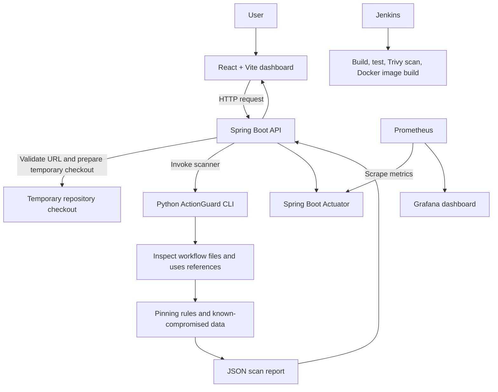
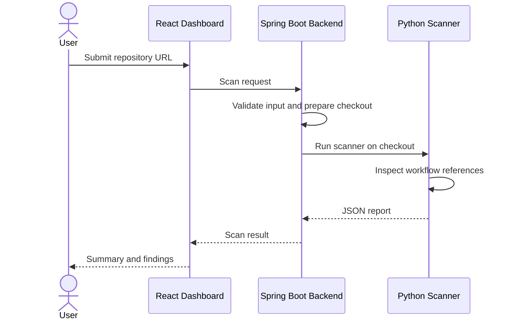
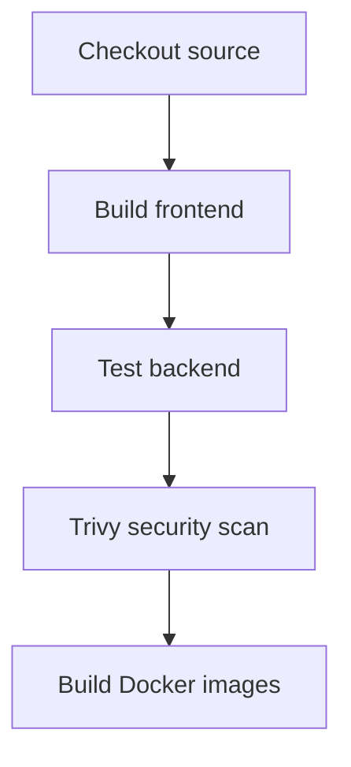

# ActionGuard Dashboard

**ActionGuard** is a local web dashboard for identifying risky GitHub Actions workflow references, including actions that are not pinned to a full commit SHA and actions listed as known compromised. It combines a React frontend, a Spring Boot API, and a Python-based scanner.

The project also demonstrates a DevOps workflow with Jenkins, Trivy filesystem scanning, Docker Compose, and Prometheus/Grafana monitoring.

> **Status:** Local prototype. This README does not claim that the application is publicly deployed. Review the security section before exposing the API to the internet.

## Table of contents

- [Overview](#overview)
- [Why ActionGuard exists](#why-actionguard-exists)
- [Features](#features)
- [Architecture](#architecture)
- [How a scan works](#how-a-scan-works)
- [Technology stack](#technology-stack)
- [Related repositories](#related-repositories)
- [Repository structure](#repository-structure)
- [Requirements](#requirements)
- [Run locally](#run-locally)
- [Run with Docker Compose](#run-with-docker-compose)
- [Configuration](#configuration)
- [API and health checks](#api-and-health-checks)
- [Understanding scan results](#understanding-scan-results)
- [Jenkins CI/CD pipeline](#jenkins-cicd-pipeline)
- [Trivy security scanning](#trivy-security-scanning)
- [Prometheus and Grafana monitoring](#prometheus-and-grafana-monitoring)
- [Testing and troubleshooting](#testing-and-troubleshooting)
- [Security considerations](#security-considerations)
- [Limitations](#limitations)
- [Future improvements](#future-improvements)
- [Screenshots](#screenshots)
- [Contributing](#contributing)

---

## Overview

GitHub Actions workflows often use third-party actions to build, test, and deploy software. A workflow can reference an action with syntax such as `owner/repository@ref`. If the reference uses a mutable tag or branch rather than a full commit SHA, the code associated with that reference may change without a corresponding change to the workflow file.

ActionGuard lets a user submit a GitHub repository URL and review workflow `uses:` references identified by the scanner. It checks for unpinned references and matches against the scanner's known-compromised data.

The project has three related parts:

| Component | Purpose |
|---|---|
| **ActionGuard scanner** | Python CLI that inspects workflow files and produces a JSON report. |
| **ActionGuard demo repository** | Demonstrates vulnerable versus fixed workflow references using a fake action and fake secrets. |
| **ActionGuard Dashboard** | This repository: React frontend, Spring Boot backend, Docker configuration, and monitoring setup. |

## Why ActionGuard exists

The project is inspired by the March 2025 `tj-actions/changed-files` supply-chain incident (CVE-2025-30066), in which a trusted GitHub Action was compromised and a tag was moved to malicious code. Workflows relying on the affected mutable reference could run code different from what maintainers expected.

A workflow reference may use:

- **A tag or branch**, such as `@v1` or `@main`, which can be moved.
- **A full commit SHA**, which identifies a specific commit and is not a movable tag.

Pinning to full commit SHAs reduces risk from mutable references, but does not guarantee that the pinned code is safe.

## Features

- Submit a GitHub repository URL from the dashboard.
- Inspect `uses:` references in GitHub Actions workflow files.
- Identify references that are not pinned to a full commit SHA.
- Compare references with the scanner's known-compromised data.
- Display severity classifications and finding details provided by the scanner.
- Run the frontend, backend, and monitoring services locally using Docker Compose.
- Use Jenkins to check out the repository, build the frontend, test the backend, run Trivy filesystem scanning, and build Docker images.
- Expose Spring Boot Actuator endpoints and scrape Prometheus metrics for Grafana dashboards.

Feature behavior is governed by the code and scanner rules in the current repository. A scan is not a complete audit of a repository.

## Architecture



### Main components

- **Frontend:** React and Vite provide the browser interface.
- **Backend:** Spring Boot accepts scan requests and coordinates scanner execution.
- **Scanner:** Python CLI examines workflow references and generates findings.
- **Docker Compose:** defines the local application and monitoring services.
- **Jenkins:** automates the configured build and verification stages.
- **Trivy:** performs the filesystem security scan configured in the Jenkins pipeline.
- **Prometheus and Grafana:** collect and display backend metrics.

## How a scan works

1. A user enters a GitHub repository URL in the dashboard.
2. The frontend sends a request to the Spring Boot backend.
3. The backend validates the URL and prepares a temporary checkout.
4. The backend invokes the Python ActionGuard scanner.
5. The scanner examines workflow references using its configured rules and known-compromised data.
6. The scanner produces a JSON report.
7. The backend returns the report for the frontend to display.
8. The temporary checkout is intended to be removed after the scan completes.



## Technology stack

| Area | Technology |
|---|---|
| Frontend | React, Vite, JavaScript, CSS |
| Backend | Java 21, Spring Boot, Maven |
| Scanner | Python |
| Version control | Git and GitHub |
| CI/CD | Jenkins |
| Backend testing | JUnit and Spring MVC test tooling, as configured in Maven |
| Security scanning | Trivy filesystem scan |
| Containers | Docker and Docker Compose |
| Metrics and health | Spring Boot Actuator, Micrometer, Prometheus |
| Dashboards | Grafana |

## Related repositories

The project documentation refers to these companion repositories:

- **`actionguard`** — the Python scanner invoked by the dashboard.
- **`actionguard-demo`** — demonstration repository containing vulnerable and fixed workflow examples and safe attack-replay scripts.
- **`ActionGuard-Dashboard`** — this repository.

Make sure the companion scanner is available and that the scanner path and invocation settings match your checkout layout.

## Repository structure

```text
action-guard-dashboard/
├── backend/
│   ├── src/main/java/          # Spring Boot application and API controllers
│   ├── src/main/resources/     # Application configuration
│   ├── src/test/java/          # Backend tests
│   ├── pom.xml
│   └── Dockerfile
├── frontend/
│   ├── src/                    # React interface
│   ├── package.json
│   ├── vite.config.js
│   ├── nginx.conf
│   └── Dockerfile
├── prometheus/
│   └── prometheus.yml          # Prometheus scrape configuration
├── docker-compose.yml
└── README.md
```

This is a high-level view; check the current repository tree for exact paths as the project evolves.

## Requirements

For a local development workflow:

- Git
- Java Development Kit 21
- Node.js and npm
- Python 3
- A local checkout of the ActionGuard Python scanner
- Access to the public GitHub repository being scanned

For the containerized workflow:

- Docker Desktop or Docker Engine
- Docker Compose
- Internet access to pull images and resolve dependencies on the first build

## Run locally

### 1. Clone the dashboard

```bash
git clone https://github.com/Srishti018/ActionGuard-Dashboard.git
cd ActionGuard-Dashboard
```

### 2. Start the backend

In a terminal:

```powershell
cd backend
.\mvnw.cmd spring-boot:run
```

On macOS/Linux, if the Maven wrapper is present and executable:

```bash
./mvnw spring-boot:run
```

The backend is configured to listen on port `8081`.

### 3. Start the frontend

Open a second terminal:

```powershell
cd frontend
npm install
npm run dev
```

Vite normally serves the development frontend at `http://localhost:5173`.

### 4. Try a scan

1. Open the frontend in your browser.
2. Enter a public GitHub repository URL you are authorized to assess.
3. Submit the scan and review the summary and findings.

The scanner is a separate component. If scans fail, verify that the scanner repository is checked out where the backend expects it and that Python is installed and accessible.

## Run with Docker Compose

From the repository root, build and start the services:

```powershell
docker compose up --build -d
```

Check service status:

```powershell
docker compose ps
```

Inspect logs:

```powershell
docker compose logs --tail=100
```

Follow a particular service's logs:

```powershell
docker compose logs -f backend
```

Stop the services:

```powershell
docker compose down
```

### Local service URLs

The current local Compose setup is intended to expose these ports; check `docker-compose.yml` if your local mappings differ.

| Service | Local URL | Purpose |
|---|---|---|
| Dashboard | `http://localhost:3000` | Frontend served by the container's web server |
| Backend | `http://localhost:8081` | Spring Boot API |
| Backend health | `http://localhost:8081/actuator/health` | Actuator health endpoint |
| Prometheus | `http://localhost:9090` | Scrape status and metrics queries |
| Grafana | `http://localhost:3001` | Monitoring dashboards |

These are local development endpoints, not public deployment URLs.

## Configuration

Configuration may differ between the host, Docker containers, and Jenkins. Check the backend configuration and Compose file before changing values.

| Setting | Purpose |
|---|---|
| `ACTIONGUARD_SCANNER_DIR` | Scanner checkout location in the Docker backend configuration, where configured |
| `ACTIONGUARD_PYTHON` | Python executable used to invoke the scanner, where configured |
| `server.port` | Spring Boot HTTP port; configured as `8081` in this project |

Some older setup notes may refer to `SCANNER_DIR` and `PYTHON_EXECUTABLE`. Do not assume these names are interchangeable: use the names read by the current backend code and Dockerfile.

### Secrets

- Do not commit API tokens, passwords, webhook URLs, or `.env` files containing secrets.
- Use Jenkins credentials or environment variables for sensitive values.
- Never put secrets in screenshots or example commands.
- Avoid exposing Prometheus or Grafana publicly without authentication and an explicit access-control plan.

## API and health checks

The backend exposes a Spring Boot Actuator health endpoint:

```text
GET /actuator/health
```

Test it locally with:

```powershell
curl.exe http://localhost:8081/actuator/health
```

The application configuration also enables the Actuator Prometheus endpoint:

```text
GET /actuator/prometheus
```

The scan API is implemented in the backend controller. Check `ScanController.java` for the exact route, HTTP method, request schema, and response shape before relying on an endpoint contract; these details are intentionally not guessed here.

## Understanding scan results

The scanner returns a JSON report containing a summary and findings. The exact report fields depend on the scanner implementation. The following is an **illustrative example**, not a guarantee that every scan returns these exact values or wording:

```json
{
  "root": "cloned-repo",
  "summary": {
    "total": 2,
    "high": 1,
    "critical": 0,
    "pinned": 1
  },
  "findings": [
    {
      "file": ".github/workflows/example.yml",
      "line": 14,
      "action": "owner/action@v1",
      "status": "unpinned",
      "severity": "HIGH",
      "message": "Action is referenced by a mutable tag instead of a full commit SHA."
    }
  ]
}
```

| Field | Meaning |
|---|---|
| `file` | Workflow file containing the reference |
| `line` | Line number reported by the scanner |
| `action` | Action reference examined |
| `status` | Scanner classification, such as pinned or unpinned |
| `severity` | Severity assigned by configured rules |
| `message` | Explanation supplied by the scanner |

A finding is a signal to investigate, not proof that a repository is exploitable. A report with no findings does not guarantee that a repository or its workflows are safe.

## Jenkins CI/CD pipeline

The Jenkins pipeline currently configured for this project has these stages:



### Stage overview

1. **Checkout** — obtains source code from version control.
2. **Build Frontend** — installs frontend dependencies and runs the frontend build.
3. **Test Backend** — invokes the Maven wrapper to run backend tests.
4. **Trivy Security Scan** — runs the configured filesystem scan for vulnerability and misconfiguration checks.
5. **Build Docker Images** — builds the application container images.

The pipeline can stop at the first failing stage. Review that stage's console output to identify the cause. For example, Maven cannot run tests if `backend/pom.xml` is malformed XML.

> **Deployment status:** The stages above cover checkout, build, test, scanning, and image building. Do not claim that Jenkins automatically deploys the application unless a deployment stage has been added and verified.

If Jenkins is triggered by a GitHub webhook through a temporary Cloudflare Tunnel, the tunnel must be running and the webhook must point to the current tunnel URL. A stopped or changed temporary tunnel can interrupt webhook delivery, but it does not prevent manual builds or normal Git pushes.

## Trivy security scanning

Trivy is included in the Jenkins pipeline to scan the project filesystem. The configured command has used scanners such as:

```powershell
trivy fs --scanners vuln,misconfig --exit-code 0 .
```

The exact command in the Jenkins job is authoritative. With `--exit-code 0`, findings do not by themselves force a nonzero exit code, so this invocation should not be described as a strict build-blocking security gate. A filesystem scan also does not prove that every container image, runtime configuration, or application behavior has been assessed.

Use the pipeline log to confirm what was scanned and whether findings were reported. Document image scanning separately only if it has been implemented and verified.

## Prometheus and Grafana monitoring

The backend is configured with Spring Boot Actuator and Micrometer's Prometheus registry. Prometheus scrapes the backend's Actuator Prometheus endpoint using the service name on the Docker Compose network.

### Local monitoring endpoints

- Prometheus: `http://localhost:9090`
- Prometheus targets: `http://localhost:9090/targets`
- Grafana: `http://localhost:3001`

The backend target should show **UP** in Prometheus when scraping succeeds.

### Dashboard panels

The ActionGuard Monitoring dashboard created for this project includes panels for:

- Backend CPU usage (`process_cpu_usage`)
- JVM memory usage (`jvm_memory_used_bytes`)
- Backend scrape status (`up{job="actionguard-backend"}`)

Metric availability can vary with the running application and exporter configuration. JVM memory can produce multiple time series, for example for different memory pools.

If the dashboard shows no data:

1. Check that backend, Prometheus, and Grafana containers are running.
2. Visit Prometheus `/targets` and confirm the backend target is **UP**.
3. Check `prometheus/prometheus.yml`.
4. When Grafana runs on the same Compose network, confirm its Prometheus data source uses `http://prometheus:9090`.
5. Check the relevant container logs.

Do not expose monitoring endpoints publicly without reviewing authentication, network access, and metric sensitivity.

## Testing and troubleshooting

### Check containers

```powershell
docker compose ps
docker compose logs --tail=100 backend
docker compose logs --tail=100 frontend
docker compose logs --tail=100 prometheus
docker compose logs --tail=100 grafana
```

### Maven reports a non-parseable `pom.xml`

1. Open `backend/pom.xml` and check that the XML declaration appears only once and is the first content in the file.
2. Check the committed version as well as the local working copy.
3. Inspect the file in the Jenkins workspace after checkout.
4. Fix the source file, commit the correction, and push it so a fresh Jenkins checkout receives it.

Editing only Jenkins' temporary workspace will not persist after another checkout.

### Frontend does not open

- Confirm the frontend container is running.
- Verify the host port mapping in `docker-compose.yml`.
- Inspect frontend/Nginx logs.
- For development mode, confirm Vite is running and use its displayed URL.

### Backend health check fails

- Inspect backend logs.
- Confirm port `8081` is mapped as expected.
- Verify the backend started successfully before testing `/actuator/health`.

### Scan fails

- Confirm the repository URL is valid and accessible to the scanner.
- Check the configured scanner directory and Python executable.
- Review backend logs for clone, timeout, or scanner execution errors.
- Confirm the backend process can create and remove temporary checkouts.

### Prometheus target is DOWN

- Check that the backend container is running.
- Confirm the target uses the Compose service name and port, such as `backend:8081`.
- Verify the Actuator Prometheus endpoint is enabled and reachable from the Prometheus container.

## Security considerations

ActionGuard is a prototype security tool and should be run with appropriate safeguards.

- Only scan repositories you are authorized to assess.
- Treat submitted repository URLs as untrusted input.
- If the scan endpoint is accessible without authentication, anyone who can reach it may request scans. Add authentication or access restrictions, rate limits, request validation, timeouts, and resource limits before public exposure.
- Review URL validation and clone behavior to reduce server-side request forgery (SSRF), internal-network access, and unsafe URL handling risks.
- Keep the scanner isolated and avoid executing scripts or workflows from scanned repositories.
- Ensure temporary checkouts and generated reports are handled safely and cleaned up as intended.
- Keep dependencies updated and review Trivy output.
- Do not commit secrets. Use dedicated secret storage for Jenkins credentials.
- Keep Prometheus and Grafana private unless there is a deliberate, secured access design.
- A scanner result is not a substitute for a full security review.

**The application is intended for local use at this stage. Do not expose the scan endpoint publicly until access controls and resource-abuse protections have been reviewed.**

## Limitations

- Detection is limited to checks implemented by the Python scanner and its known-compromised data.
- A known-compromised list can become outdated and may not include every malicious action.
- Mutable-reference detection does not establish whether the referenced action is otherwise safe.
- Scans run on demand; persistent scan history is not documented as implemented.
- Large repositories, unavailable repositories, rate limits, network errors, and malformed inputs may affect scan behavior.
- The Jenkins pipeline described here covers checkout, frontend build, backend tests, Trivy filesystem scanning, and Docker image building; automatic deployment is not claimed.
- Trivy filesystem scanning is not a complete application or runtime security audit.
- Public deployment, authentication, and abuse prevention require further work.

## Future improvements

- Persist scan history and reports in a database.
- Improve scan failure messages and timeout handling.
- Add authentication, rate limiting, and stronger request validation before any shared deployment.
- Improve scanner coverage and the maintenance process for known-compromised data.
- Add verified container-image scanning to the pipeline if required.
- Add automated tests for scanner findings and edge cases.
- Document and test a deployment stage only after it is implemented.
- Expand monitoring and alerting based on operational requirements.

## Screenshots

Add screenshots captured from the real, running application. Save them under `docs/screenshots/` and update the paths below. Do not use mockups as evidence of implemented behavior.

| Screenshot | Suggested file |
|---|---|
| Main dashboard | `docs/screenshots/dashboard.png` |
| Scan results for a public test repository | `docs/screenshots/scan-results.png` |
| Successful Jenkins Stage View | `docs/screenshots/jenkins-pipeline.png` |
| Prometheus target showing the backend as UP | `docs/screenshots/prometheus-targets.png` |
| Grafana ActionGuard Monitoring dashboard | `docs/screenshots/grafana-dashboard.png` |

Once the images exist, embed them like this:

```markdown

```

## Contributing

Contributions and suggestions are welcome. A useful contribution workflow is:

1. Open an issue describing the bug, improvement, or proposed rule.
2. Create a focused branch for the change.
3. Make the change and add or update tests where applicable.
4. Run the relevant frontend build and backend tests locally.
5. Open a pull request describing the change, validation performed, and any security implications.

Avoid including credentials, private repository contents, or real secrets in issues, logs, screenshots, and test fixtures.
